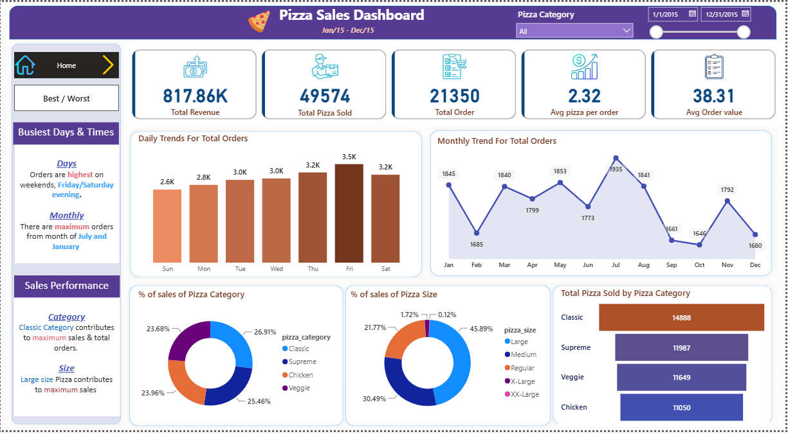
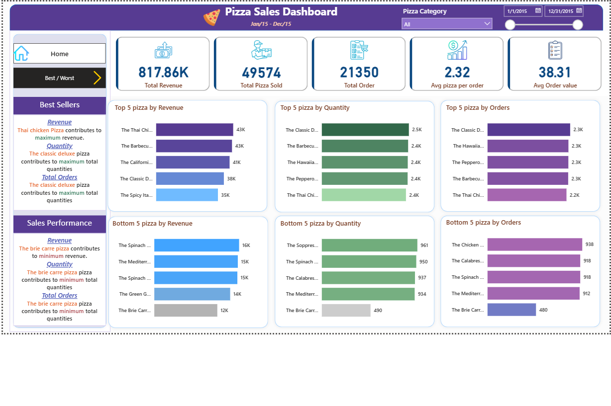

# 🍕 Pizza Sales Analysis & Performance Dashboard (Power BI)

## Executive Summary
This project presents a comprehensive end-to-end data analysis of sales performance for a pizza business operating over a full calendar year. Using **Power BI** and **DAX**, this interactive dashboard tracks key performance indicators (KPIs), identifies sales trends across daily and monthly cycles, analyzes product mix preferences, and classifies top and bottom-performing menu items to support data-driven business decision-making.

## Key Business Metrics (KPIs)
- **Total Revenue:** $817.9K
- **Total Orders:** 21,350
- **Total Pizzas Sold:** 49,574 (or ~50K)
- **Average Order Value (AOV):** $38.31
- **Average Pizzas Per Order:** 2.32

---

## Key Business Insights & Findings

### 1. Sales Trends & Peak Activity
- **Daily Trend:** Peak order volumes occur on **Friday and Saturday evenings**, driven by weekend dining demand.
- **Monthly Trend:** Highest sales volumes are recorded in **July and January**, showing seasonal spikes during holiday and summer periods.

### 2. Product Category & Size Analysis
- **Top Category:** The **Classic** category accounts for the highest volume of total pizzas sold (**14,888 units**), while contributing significantly to overall sales revenue alongside the **Supreme** category.
- **Preferred Size:** **Large size pizzas** dominate customer demand, accounting for **45.89%** of total sales, followed by Medium size pizzas (**30.49%**).

### 3. Best vs. Worst Sellers Analysis
- **Top Revenue Generator:** **The Thai Chicken Pizza** contributes the highest revenue ($43K+).
- **Top Volume Leader:** **The Classic Deluxe Pizza** achieves the maximum total quantity sold and highest number of total orders.
- **Lowest Performer:** **The Brie Carre Pizza** yields the lowest revenue ($12K), total quantity sold, and lowest order frequency, indicating a potential candidate for menu optimization or promotional redesign.

---

## Tech Stack & Methodology
- **Data Visualization & Analytics:** Power BI Desktop
- **Data Modeling & Calculations:** DAX (Data Analysis Expressions) for dynamic KPIs and measures
- **Data Transformation:** Power Query for ETL processes, data cleaning, and data type alignment
- **Data Structure:** Relational transactional sales dataset covering order dates, times, pizza types, sizes, quantities, and prices

---

## Dashboard Preview

### Page 1: Sales Overview & Trends

### Page 2: Best & Worst Sellers Analysis

---

## Strategic Recommendations
1. **Inventory Management:** Optimize raw material supply chains ahead of high-demand periods (Friday/Saturday evenings and July/January peak months).
2. **Menu Engineering:** Re-evaluate or substitute underperforming menu items like *The Brie Carre Pizza* with targeted promotional strategies or replacement options.
3. **Bundle Offers:** Create cross-promotional combo deals combining high-revenue pizzas (*The Thai Chicken*) with popular sizes to increase Average Order Value (AOV).

---
